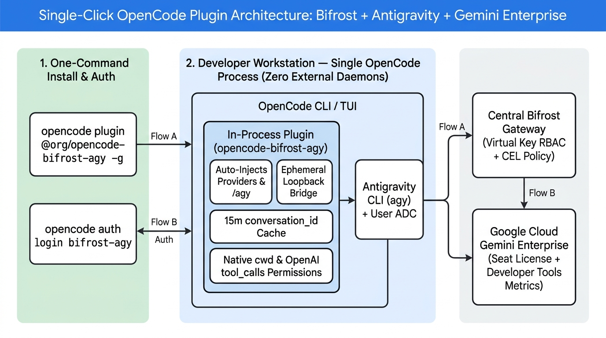

# `opencode-bifrost-agy`

**Zero-daemon OpenCode plugin integrating the [Bifrost AI Gateway](https://github.com/maximhq/bifrost), Google Antigravity CLI (`agy`), and Google Cloud Gemini Enterprise seats.**



---

## Overview

`opencode-bifrost-agy` collapses the multi-service workstation glue between **OpenCode**, **Bifrost AI Gateway** (central enterprise HTTPS or local loopback), **Antigravity CLI (`agy`)**, and **Gemini Enterprise** into a **single in-process OpenCode plugin**:

- **Zero External Daemons:** Runs natively inside OpenCode's Bun runtime (`Bun.serve` auto-unref'd and cleaned up via `dispose()`)—eliminating external Python/`uv` virtual environments, `systemd`/`launchd` services, and 70-line `opencode.json` provider boilerplate.
- **Centralized Bifrost Policy Governance:** Standard prompts use your default Bifrost Virtual Key (`vkDefault` &rarr; Vertex AI / Anthropic / OpenAI), while `/agy` prompts enforce Bifrost's `/agy` Virtual Key (`vkAgy`), model allowlists, tier aliases (`agy-frontier`, `agy-fast`, `agy-pro`), and **CEL routing rules** (`policy-routed`).
- **Per-User Gemini Enterprise Seat & Metrics Attribution:** Strips Pay-As-You-Go API key overrides and runs `agy` locally under the developer's human `authorized_user` Application Default Credentials (`AGY_ADC_AUTH=true`) with `BAICODE_USER_TIER` telemetry enabled for **Gemini Enterprise > Developer tools metrics**.
- **15-Minute Implicit Cache Continuity (`--conversation <id>`):** Maintains a bounded 900-second session prefix map so follow-up prompts and tool continuations reuse the active `agy` `conversation_id`, maximizing Google Cloud's 5–15 minute implicit cache hits (`cache_read_tokens`).
- **Dynamic Workspace Binding & Native OpenCode Permissions:** Automatically scopes `agy` (`cwd` + `--add-dir`) to your active OpenCode repository and translates gated `agy` actions (`run_command`, outside-repo `read_file`, or `strict` `write_file`) into OpenAI `tool_calls` (`bash`, `read`, `write`) so OpenCode displays its native **`Allow once` / `Always allow` / `Reject`** prompt.

---

## 60-Second Quickstart

```bash
# 1. One-time workstation prerequisites: Antigravity CLI + Human Gemini Enterprise ADC
curl -fsSL https://antigravity.google/cli/install.sh | bash
gcloud auth application-default login --project="<YOUR_GEMINI_ENTERPRISE_GCP_PROJECT_ID>"

# 2. Install the plugin globally in OpenCode
opencode plugin github:shashirr-droid/opencode-bifrost-agy -g

# 3. Configure Bifrost URL, Virtual Keys & Gemini Enterprise tier interactively
opencode auth login
# -> Select "Antigravity CLI (Bifrost Policy + Gemini Enterprise Plugin)"

# 4. Verify readiness and start coding in any repository
cd ~/your-project
opencode run --command agy-doctor ""
opencode
```

Inside OpenCode:
- **Normal prompt (`Enter`):** Uses your standard Bifrost model (`vertex/*`, `anthropic/*`) with zero `agy` seat usage.
- **`/agy <task>`:** Executes via Antigravity CLI under Bifrost's active `policy-routed` model policy.
- **`/agy-frontier <task>` | `/agy-fast <task>` | `/agy-pro <task>`:** Executes using Bifrost's configured model aliases.
- **`/agy-doctor`:** Audits `agy`, human ADC (`authorized_user`), `BAICODE_USER_TIER`, and Bifrost Virtual Key RBAC.

---

## Documentation

| Document | Contents |
| :--- | :--- |
| **[Installation & Configuration Guide](docs/INSTALLATION_AND_CONFIGURATION.md)** | Dedicated step-by-step setup across **Google Cloud Gemini Enterprise**, **Antigravity CLI (`agy`)**, **Bifrost AI Gateway** (`bifrost.env` & `config.json`), **OpenCode Plugin installation** (Interactive CLI vs. Declarative `opencode.json`), **Requisite Parameters Reference**, and **Troubleshooting**. |
| **[Architecture & Request / Coding-Task Data Flows](docs/ARCHITECTURE_AND_DATA_FLOW.md)** | Detailed component architecture, trust boundaries (`central-bifrost` vs. `through-bifrost`), **Standard Request Flow**, and the 6-stage **Agentic `/agy` Coding Task Data Flow** (workspace `cwd`, OpenCode permission delegation, and 15-minute `--conversation <id>` implicit cache hits). |
| **[Example Config Templates](examples/)** | Sanitized ready-to-adapt templates: [`bifrost.env.example`](examples/bifrost.env.example), [`bifrost.config.example.json`](examples/bifrost.config.example.json), and [`opencode.json.example`](examples/opencode.json.example). |

---

## License

Apache-2.0 — see [LICENSE](LICENSE).
