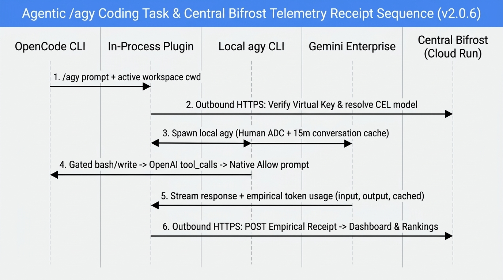

# System Architecture, Request Flows & Central Bifrost Telemetry

This document details the architecture of **`opencode-bifrost-agy` (`v2.0.6`)** and traces the exact runtime data flows for both a **standard LLM request** and a **multi-step agentic `/agy` coding task**—including how remote workstation `agy` usage is recorded in a **Central Cloud Run Bifrost Dashboard** without opening any inbound ports on developer machines.

---

## 1. End-to-End Split-Plane Architecture

### 1.1 Component Roles & Trust Boundaries

| Component | Runtime Boundary | Core Responsibilities |
| :--- | :--- | :--- |
| **OpenCode CLI / TUI** | Developer Workstation | Terminal coding agent & UI. Captures user prompts, injects workspace metadata (`<env>`), executes approved local tools (`bash`, `read`, `write`, `edit`), and renders native permission modals (`Allow once` / `Always allow` / `Reject`). |
| **`opencode-bifrost-agy` Plugin (`v2.0.6`)** | In-Process inside OpenCode (Bun) | Zero-daemon, zero-dependency V2/V1 integration bridge (`{ id, setup(ctx) }` + `server()`). Auto-discovers models, enforces remote Bifrost Virtual Keys & CEL rules, maintains a **15-minute `conversation_id` cache map**, binds `agy` dynamically to the active repository (`cwd`), translates `agy` permission denials into OpenAI `tool_calls`, and posts **Empirical Telemetry Receipts** to Central Bifrost. |
| **Bifrost AI Gateway (`bifrost-http`)** | Google Cloud Run / GKE *or* Local Loopback | Enterprise policy & observability plane. Enforces **Virtual Key RBAC** (`vkDefault` vs. `vkAgy`), rate/budget limits, full model allowlists, tier aliases (`agy-fast`, `agy-frontier`, `agy-pro`), provider-scoped **CEL routing rules** (`policy-routed`), and **Dashboard Analytics** (`Provider Usage`, `Model Rankings`, `Virtual Key Rankings`, `Logs`). |
| **Internal Receipt Bridge (`receipt_bridge.py`)** | `127.0.0.1:8091` *inside* Central Bifrost Container | Container-private accounting endpoint used in `central-bifrost` deployments ([`deploy/cloudrun/`](../deploy/cloudrun/README.md)). Rejects direct non-receipt calls (`HTTP 502 WorkstationExecutionRequired`) while converting verified workstation `agy` telemetry receipts into OpenAI `chat.completion` responses for Bifrost's logstore. |
| **Antigravity CLI (`agy`) + Human ADC** | Developer Workstation Subprocess | Headless agentic CLI (`agy -p --output-format stream-json`). Authenticates directly against Google Cloud using the developer's personal `authorized_user` Application Default Credentials (`AGY_ADC_AUTH=true`). |
| **Google Cloud Gemini Enterprise** | Google Cloud (`businessaicode` / `discoveryengine`) | Enforces seat-level licensing, server-side `AdminControls` (`Terminal command auto-execution policy` & `Outside of file access policy`), **5–15 minute implicit prompt caching**, and **Developer tools metrics** (`SendTelemetry`). |

### 1.2 Why This Split-Plane Architecture Works

1. **Per-Human Gemini Enterprise Seat Attribution:** Gemini Enterprise entitlements (`roles/discoveryengine.agentspaceUser`) bind to individual human OAuth credentials (`"type": "authorized_user"`), not shared service accounts. Spawning `agy` locally inside the developer's OpenCode process consumes their assigned seat cleanly without exporting personal OAuth tokens to a central server.
2. **Centralized Governance & Dashboard Visibility Without Inbound Workstation Ports:**
   - **In `central-bifrost` mode** *(remote HTTPS Bifrost on Cloud Run / GKE)*: Developer laptops/VMs sit behind NAT/firewalls, so Cloud Run **never** connects inbound to `127.0.0.1` on the workstation. Every connection is **outbound HTTPS** from the workstation to Central Bifrost: first to check Virtual Key & CEL policy before spawning `agy` locally, and then to post the **Empirical Usage Receipt** after `agy` finishes so Central Bifrost's Dashboard records exact token counts, models, routing rules, and Virtual Keys.
   - **In `through-bifrost` mode** *(co-located localhost Bifrost)*: OpenCode sends `/agy` requests directly through local Bifrost (`127.0.0.1:8080`), which evaluates Virtual Key + CEL policies and forwards upstream to the plugin's embedded `127.0.0.1:8091` listener.
3. **Zero-Daemon Workstation Lifecycle:** Because `Bun.serve()` is unref'd (`embeddedServer.unref()`) and torn down on plugin unload, one-shot CLI commands exit immediately and interactive TUI sessions leave zero orphaned background processes behind.

---

## 2. Request & Agentic Coding Task Data Flows

---

### 2.1 Data Flow A: Standard LLM Request (Default Prompt)

When a developer types a standard question or coding prompt in OpenCode **without** invoking `/agy` (using the default `build` or `plan` agent):

1. **Prompt Dispatch:** OpenCode targets its default model (`bifrost/<provider>/<model>`) and sends `POST /v1/chat/completions` outbound over HTTPS directly to the Bifrost AI Gateway with `Authorization: Bearer <vkDefault>`.
2. **Gateway RBAC Enforcement:** Bifrost validates `vkDefault`. Because `vk-opencode-default` only authorizes standard providers (`vertex`, `anthropic`, `openai`) and excludes `agy-cli`, any attempt to call `agy-cli/*` with `vkDefault` is rejected in `<2ms` with `HTTP 403`.
3. **Cloud Provider Inference & Streaming:** Bifrost forwards the request to Vertex AI (using the Cloud Run Service Account's ADC) or Anthropic/OpenAI and streams OpenAI-compatible Server-Sent Event (`SSE`) token deltas directly back into OpenCode.

---

### 2.2 Data Flow B: Multi-Step Agentic Coding Task (`/agy`)

Consider a developer coding task executed inside `~/payments-service`:

> `/agy Refactor retry backoff in src/client.ts to add jitter, then run npm test and fix any failing assertions.`

Below are the six runtime stages corresponding to the sequence diagram above:

#### Stage 1 — Workspace & Session Capture (`http.request` / `chat.headers` Hook)
OpenCode switches to the `agy` agent (`bifrost-agy/agy-cli/policy-routed`) and passes the active project directory (`~/payments-service`), session ID, and client `tools[]` (`bash`, `read`, `write`, `edit`) to the in-process plugin's ephemeral loopback server (`127.0.0.1:<random_port>`).

#### Stage 2 — Outbound Central Bifrost Virtual Key & CEL Policy Check
1. **Virtual Key RBAC:** The plugin calls `GET ${bifrostUrl}/v1/models` with `Authorization: Bearer <vkAgy>` to verify the key is active and fetch its allowed `agy-cli` model slugs (`HTTP 401`/`403` blocks unauthorized callers immediately).
2. **Dynamic CEL Rule Resolution:** The plugin evaluates Central Bifrost's `/api/routing/rules` (honoring `global`, `virtual_key`, and `provider == "agy-cli"` scopes plus header predicates) to resolve `policy-routed` or aliases (`agy-fast`, `agy-frontier`, `agy-pro`, custom `modelAliases`) to the active target `agy` model.

#### Stage 3 — Workspace-Scoped Local `agy` Execution (`accept-edits`)
The plugin strips Pay-As-You-Go API key overrides, sets `AGY_ADC_AUTH=true` and `BAICODE_USER_TIER`, validates `~/payments-service` against `allowedWorkspaceRoots`, and spawns `agy -p ... --output-format stream-json --add-dir ~/payments-service --mode accept-edits` locally on the workstation. `agy` edits `src/client.ts` directly inside the repo and streams live deltas back to OpenCode.

#### Stage 4 — Interactive Permission Surfacing to OpenCode (`denied_actions` &rarr; OpenAI `tool_calls`)
When `agy` attempts a gated action such as `run_command` (`npm test`) under `Require review`, `agy` emits `denied_actions` + `conversation_id: "<agy_uuid>"`. The plugin translates the denied action into a standard OpenAI streaming **`tool_calls`** chunk (`bash`, `read`, or `write`), prompting the developer natively inside OpenCode (**`Allow once` / `Always allow` / `Reject`**).

#### Stage 5 — Stateful `--conversation <id>` Resumption & GCP Implicit Cache Hit (`5–15 min` TTL)
Once the developer approves `npm test`, OpenCode sends the tool output in a follow-up request. The plugin matches the conversation prefix in its **900-second (`15-min`) session map** and resumes `agy -p "<delta>" --conversation <agy_uuid>`, hitting Google Cloud's **5–15 minute implicit prompt cache** (`cache_read_tokens > 0`).

#### Stage 6 — Dual Telemetry: Gemini Enterprise Metrics + Central Bifrost Receipt Bridge (`v2.0.6`)

**In plain language—how does a remote Cloud Run Bifrost server record `agy` tokens when `agy` ran on your laptop?**
Think of it like an **itemized expense receipt**:
1. Central Bifrost on Cloud Run **cannot** reach into your laptop to run `agy`, so your laptop runs `agy` locally using your personal Gemini Enterprise seat.
2. When `agy` finishes a turn, its `stream-json` output prints an exact "meter reading" from Gemini Enterprise (`input_tokens`, `output_tokens`, `thinking_tokens`, `cache_read_tokens`, `total_tokens`).
3. Before closing the response stream, the OpenCode plugin packages those exact numbers into a base64 **Empirical Telemetry Receipt** (`AGY_EMPIRICAL_RECEIPT_V1:...`) and sends a fast (~12ms) **outbound HTTPS `POST /v1/chat/completions`** to Central Bifrost using your `vkAgy` Virtual Key.
4. Central Bifrost (`:8080`) validates your `vkAgy` key, evaluates the matching CEL routing rule (recording `routing_rule_id`), and hands the request over internal container loopback to **`receipt_bridge.py` (`127.0.0.1:8091`)** running inside the same Cloud Run container.
5. `receipt_bridge.py` checks for the receipt:
   - If someone called Cloud Run directly *without* a receipt, it rejects with `HTTP 502 WorkstationExecutionRequired` (since Cloud Run never runs `agy`).
   - With a valid receipt, it returns a standard OpenAI `chat.completion` JSON envelope containing the verbatim token counts and resolved model—so Bifrost writes a complete `chat_completion` record into its Dashboard (`Provider Usage`, `Provider Token Usage`, `Model Rankings`, `Virtual Key Rankings`, and `Logs`) while **Gemini Enterprise > Developer tools metrics** simultaneously records seat telemetry via `SendTelemetry`.
