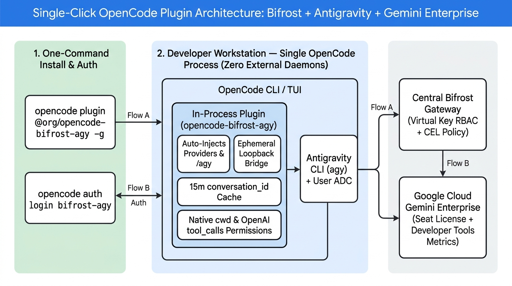

# System Architecture & Request / Coding-Task Data Flows

This document details the architecture of **`opencode-bifrost-agy`** and traces the exact runtime data flows for both a **standard LLM request** and a **multi-step agentic `/agy` coding task** across OpenCode, the Bifrost AI Gateway, Google Antigravity CLI (`agy`), and Google Cloud Gemini Enterprise.

---

## 1. End-to-End System Architecture



### 1.1 Component Roles & Trust Boundaries

| Component | Runtime Boundary | Core Responsibilities |
| :--- | :--- | :--- |
| **OpenCode CLI / TUI** | Developer Workstation | Terminal coding agent & UI. Captures user prompts, injects workspace metadata (`<env>`), executes approved local tools (`bash`, `read`, `write`, `edit`), and renders native permission modals (`Allow once` / `Always allow` / `Reject`). |
| **`opencode-bifrost-agy` Plugin** | In-Process inside OpenCode (Bun) | Zero-daemon V2/V1 integration bridge (`Plugin.define({ id, setup(ctx) })` + `server()`). Auto-discovers models (`ctx.provider.transform`), registers `/connect` (`opencode auth login bifrost-agy`) form prompts, manages an ephemeral loopback listener (`Bun.serve`), maintains a **15-minute `conversation_id` cache map**, binds `agy` dynamically to the active repository (`cwd`), and translates `agy` permission denials into OpenAI `tool_calls`. |
| **Bifrost AI Gateway** | Enterprise Central VPC *or* Local Loopback | Policy control plane. Enforces **Virtual Key RBAC** (`vkDefault` vs. `vkAgy`), rate/budget limits, model allowlists, tier aliases (`agy-frontier`, `agy-fast`, `agy-pro`), and **CEL routing rules** (`policy-routed`). |
| **Antigravity CLI (`agy`) + User ADC** | Developer Workstation Subprocess | Headless agentic CLI (`agy -p --output-format stream-json`). Authenticates against Google Cloud using the developer's personal `authorized_user` Application Default Credentials (`AGY_ADC_AUTH=true`). |
| **Google Cloud Gemini Enterprise** | Google Cloud (`businessaicode` / `discoveryengine`) | Enforces seat-level licensing, server-side `AdminControls` (`Terminal command auto-execution policy` & `Outside of file access policy`), **5–15 minute implicit prompt caching**, and **Developer tools metrics** (`SendTelemetry`). |

### 1.2 Why This Split-Plane Architecture Works

1. **Per-Human Gemini Enterprise Seat Attribution:** Gemini Enterprise entitlements (`roles/discoveryengine.agentspaceUser`) bind to individual human OAuth credentials (`"type": "authorized_user"`), not shared service accounts. Spawning `agy` locally inside the developer's OpenCode process consumes their assigned seat cleanly without exporting personal OAuth tokens to a central gateway.
2. **Centralized Policy Governance Without Inbound Laptop Ports:**
   - **In `central-bifrost` mode** *(remote HTTPS Bifrost)*: Developer laptops sit behind NAT/VPN, so Central Bifrost never connects inbound to the workstation. Instead, the plugin binds an OS-assigned ephemeral loopback port (`127.0.0.1:<random_port>`) and makes **outbound HTTPS calls** to Central Bifrost (`GET /v1/models` and `/api/routing/rules`) to enforce Virtual Key allowlists and resolve `policy-routed` before invoking `agy` locally.
   - **In `through-bifrost` mode** *(co-located localhost Bifrost)*: OpenCode sends `/agy` requests directly through local Bifrost (`127.0.0.1:8080`), which evaluates Virtual Key + CEL policies and forwards upstream to the plugin's embedded `127.0.0.1:8091` listener—giving full gateway request/token logging with zero external Python or `systemd` services.
3. **Zero-Daemon Lifecycle:** Because `Bun.serve()` is unref'd (`embeddedServer.unref()`) and torn down inside OpenCode's cleanup function (`setup(ctx)` return callback in V2 / `dispose()` in V1), one-shot CLI commands exit immediately and interactive TUI sessions leave zero orphaned background processes behind.

---

## 2. Request & Agentic Coding Task Data Flows


---

### 2.1 Data Flow A: Standard LLM Request (Default Prompt)

When a developer types a standard question or coding prompt in OpenCode **without** invoking `/agy` (using the default `build` or `plan` agent):

1. **Prompt Dispatch:** OpenCode targets its default model (`bifrost/<provider>/<model>`) and sends `POST /v1/chat/completions` directly to the Bifrost AI Gateway with `Authorization: Bearer <vkDefault>`.
2. **Gateway RBAC Enforcement:** Bifrost validates `vkDefault`. Because `vk-opencode-default` only authorizes standard providers (`vertex`, `anthropic`, `openai`) and excludes `agy-cli`, any attempt to call `agy-cli/*` with `vkDefault` is rejected in `<2ms` with `HTTP 403`.
3. **Cloud Provider Inference & Streaming:** Bifrost forwards the request to Vertex AI (via gateway ADC) or Anthropic/OpenAI and streams OpenAI-compatible Server-Sent Event (`SSE`) token deltas directly back into OpenCode.
4. **Isolation Outcome:** Zero `agy` subprocesses are spawned and zero Gemini Enterprise agent turns are consumed.

---

### 2.2 Data Flow B: Multi-Step Agentic Coding Task (`/agy`)

Consider a realistic developer coding task executed inside `~/payments-service`:

> `/agy Refactor retry backoff in src/client.ts to add jitter, then run npm test and fix any failing assertions.`

Below is the exact six-stage data flow across every component:

#### Stage 1 — Workspace & Session Capture (`http.request` / `chat.headers` Hook)
1. As `/agy` triggers, OpenCode switches to the `agy` agent (`bifrost-agy/agy-cli/policy-routed`) and invokes the plugin's outbound request hook (`ctx.session.hook("http.request")` in V2 / `"chat.headers"` in V1).
2. The plugin records OpenCode's native `sessionID` and active project directory (`~/payments-service`), attaching `x-opencode-session-id` and `x-opencode-workspace-dir` alongside OpenCode's `<env> Working directory: .../payments-service </env>` system block and client `tools[]` definitions (`bash`, `read`, `write`, `edit`).

#### Stage 2 — Bifrost Virtual Key & CEL Policy Resolution
1. **Virtual Key Validation:** Bifrost (directly in `through-bifrost` mode, or via outbound `GET ${bifrostUrl}/v1/models` in `central-bifrost` mode) verifies that `vkAgy` is active and retrieve its allowed `agy-cli` model slugs. Revoked keys fail immediately with `HTTP 401`; disallowed models fail with `HTTP 403`.
2. **Dynamic Model Routing:** Bifrost's `rule-agy-global-default-model` CEL expression rewrites the logical `policy-routed` slug to the organization's active target model (for example, `gemini-2.5-pro`).

#### Stage 3 — Workspace-Scoped `agy` Execution & Repository Edits (`accept-edits`)
1. The plugin constructs an isolated subprocess environment: it strips Pay-As-You-Go override variables (`AGY_LLM_GATEWAY_URL`, `AGY_LLM_GATEWAY_API_KEY`, `GEMINI_API_KEY`, `GOOGLE_API_KEY`, `AGY_USE_BAIC_FETCH_CONFIG`) and injects `AGY_ADC_AUTH=true`, `GOOGLE_CLOUD_PROJECT`, `GOOGLE_CLOUD_QUOTA_PROJECT`, `GOOGLE_CLOUD_LOCATION`, and `BAICODE_USER_TIER`.
2. It validates `~/payments-service` against `allowedWorkspaceRoots` and spawns:
   ```text
   agy -p "<prompt>" --model <resolved_model> --output-format stream-json \
       --disable-slash-commands --add-dir ~/payments-service --mode accept-edits
   ```
   with `cwd = ~/payments-service`.
3. Inside `~/payments-service`, `agy` reads `src/client.ts` and applies the retry-jitter edit directly (authorized by `--add-dir` + `--mode accept-edits`), streaming live `agent_response` text deltas back to OpenCode as `chat.completion.chunk` SSE events.
   - *Outside-Repo Protection:* If the task instead attempts to read a file **outside** `~/payments-service` while Gemini Enterprise's `Outside of file access policy` is `Always ask` or `Deny`, Gemini Enterprise `AdminControls` blocks `read_file` (even if `--dangerously-skip-permissions` were passed) and triggers Stage 4 below.

#### Stage 4 — Interactive Permission Surfacing to OpenCode (`denied_actions` &rarr; OpenAI `tool_calls`)
1. Next, `agy` attempts to run `npm test` via its internal `run_command` tool.
2. Under Gemini Enterprise's recommended **`Terminal command auto-execution policy = Require review`**, `agy` does **not** hang in headless mode; instead, its `stream-json` output emits:
   - `step_update` (`step_type: "tool"`, `tool_info: { "name": "run_command", "parameters": { "CommandLine": "npm test" } }`), followed by
   - `result` (`status: "SUCCESS"`, `conversation_id: "<agy_uuid>"`, `denied_actions: [{ "action": "command", "display_name": "RunCommand" }]`).
3. **Protocol Translation:** Because OpenCode communicates with model providers over OpenAI `/v1/chat/completions` (both `opencode acp` and `agy acp` are IDE-facing ACP servers rather than client-to-server peers), the plugin translates the denied action into a standard OpenAI streaming **`tool_calls`** chunk:
   ```json
   {
     "index": 0,
     "id": "call_...",
     "type": "function",
     "function": {
       "name": "bash",
       "arguments": "{\"command\":\"npm test\",\"workdir\":\"/home/user/payments-service\"}"
     }
   }
   ```
   with `finish_reason: "tool_calls"`, and stores `(workspaceDir, canonicalTurns + [("assistant_tc", "bash")]) -> <agy_uuid>` in its 15-minute session map. *(Similarly, denied `read_file` maps to OpenCode `read`, and `strict`-mode denied `write_file` recovers `{ filePath, content }` via `--conversation <agy_uuid>` and maps to OpenCode `write`).*
4. **Native User Approval in OpenCode:** OpenCode pauses and displays its built-in permission prompt (**`Allow once` / `Always allow` / `Reject`**) for `npm test`. Once approved by the developer, OpenCode executes `npm test` locally in `~/payments-service` and captures stdout/stderr.

#### Stage 5 — Stateful `--conversation <id>` Resumption & GCP Implicit Cache Hit (`5–15 min` TTL)
1. OpenCode automatically sends a follow-up `POST /v1/chat/completions` containing the conversation history plus `{ "role": "tool", "content": "<npm test output>" }`.
2. The plugin canonicalizes the message prefix, hits the existing `<agy_uuid>` entry in its **900-second (`15-min`) TTL session map**, and spawns:
   ```text
   agy -p "<delta tool output only>" --conversation <agy_uuid> --model <resolved_model> ...
   ```
3. **Implicit Cache Utilization:** Because `agy` resumes `--conversation <agy_uuid>` within Google Cloud's **5–15 minute implicit caching window**, Gemini Enterprise serves the prior system + code context directly from implicit cache (`cache_read_tokens > 0` / `cachedContentTokenCount > 0`), inspects the `npm test` result, fixes any remaining assertion in `~/payments-service`, and streams the final summary back to OpenCode. Any subsequent developer follow-up questions within 15 minutes continue reusing `<agy_uuid>` and hitting the implicit cache.

#### Stage 6 — Dual Governance & Seat Telemetry
1. **Bifrost Gateway Telemetry:** Logs Virtual Key attribution, resolved model slug, latency, prompt/completion tokens, and `prompt_tokens_details.cached_tokens`.
2. **Gemini Enterprise Developer Tools Metrics:** Because `BAICODE_USER_TIER` is set (`gcp-ge-plus-tier` or `gcp-ge-standard-tier`), `agy` dispatches `SendTelemetry` (`200 OK`), populating `InferenceRequestLog`, `InferenceResponseLog` (`cachedContentTokenCount`), and `ClientTelemetryLog` (`toolCallsCount`) in Google Cloud's **Gemini Enterprise > Developer tools metrics** console.
